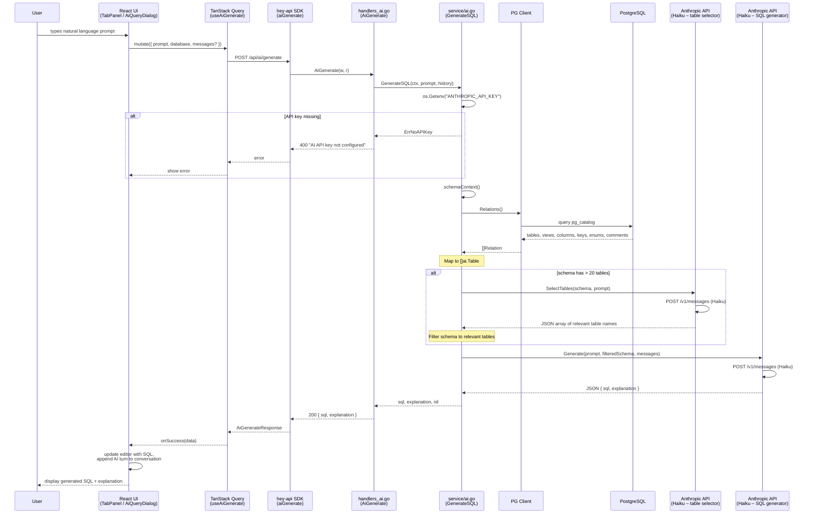

# AI SQL Generation

## Overview

Natural language to SQL generation via Anthropic Claude API. The flow uses schema-aware prompting with an optional table pre-filtering step for large databases.

## Key Files

- `internal/ai/generate.go` — Anthropic API calls (official Go SDK), schema formatting, table selection, error fixing
- `internal/service/ai.go` — Business logic: schema building, API key checks, fallback heuristics
- `internal/api/handlers_ai.go` — Thin HTTP handler (parses request, calls service, writes response)
- `frontend/src/components/ai/AiQueryDialog.tsx` — Chat-style AI dialog
- `frontend/src/components/tabs/TabPanel.tsx` — Inline AI in query tabs
- `frontend/src/api/queries.ts` — `useAiGenerate()` / `useAiFix()` mutation hooks
- `frontend/src/components/results/QueryErrorPanel.tsx` — "Fix with AI" on query errors

## Sequence Diagram

## How It Works

1. **API key** is read from the `ANTHROPIC_API_KEY` environment variable in `service/ai.go`
2. **Schema introspection** — `service.schemaContext()` calls `Client.Relations()`: tables, views and materialized views (partitions folded into their parent) with column types, primary keys, foreign-key targets, enum values and comments. `formatSchema` renders one column per line, e.g. `user_id int8 -> public.users.id`
3. **Table pre-filtering** (>20 tables only) — a cheap Haiku call receives just table names plus every user prompt in the conversation and picks the relevant subset, keeping the generation context small
4. **SQL generation** — filtered schema + conversation history + prompt sent to Haiku, which returns `{ sql, explanation }` as JSON
5. **Conversation support** — previous turns are passed as `messages[]` enabling multi-turn refinement

## Additional Endpoints

- **`POST /api/ai/fix`** — `service.FixSQL()` sends the failed SQL and PostgreSQL's error (with DETAIL, HINT and position) plus the schema, and gets back `{ sql, explanation }`. The UI offers it for errors the query text can cause, not connection, transaction-state or cancellation errors
- **`GET /api/ai/suggestions`** — `service.AISuggestions()` fetches table names from PG and asks Haiku to generate contextual query suggestions
- **`POST /api/ai/tab-name`** — `service.AITabName()` generates a short tab name from SQL; falls back to `HeuristicTabName()` (regex-based) when no API key is set or AI fails

## Models

Every call uses **Claude Haiku 5.5** (`claude-haiku-5-5`). Thinking is on by default on this model, so the effort level is set per call: `medium` for SQL generation and fixing, `low` for table selection, suggestions and tab names. Responses can start with thinking blocks, so text is read by block type.

## Response Parsing

Generation, fixing, suggestions and table selection use structured outputs (`output_config.format` with a JSON schema), so the response is always valid JSON of the expected shape. A `refusal` stop reason returns `ai.ErrRefused` (HTTP 422); a `max_tokens` stop is an error.
